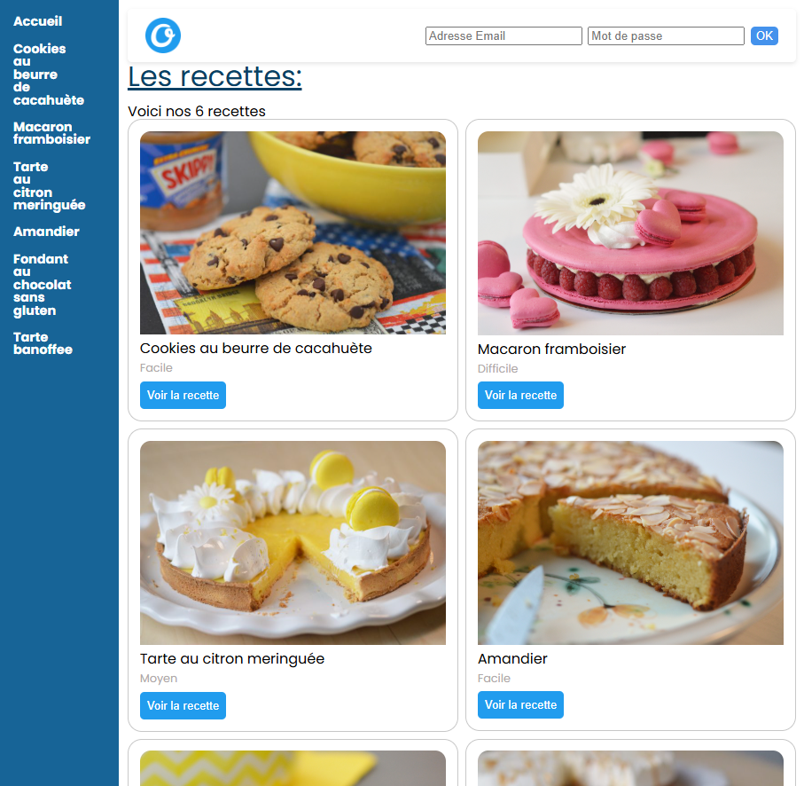
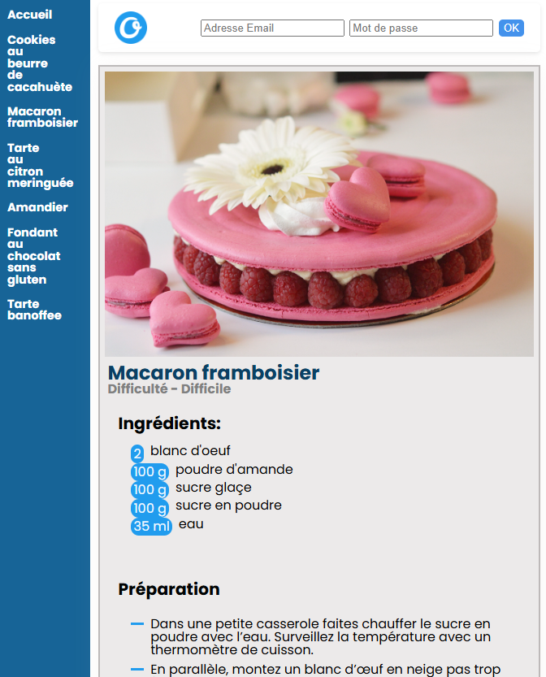

**Objectif** : réaliser une interface front en React qui affiche des recettes. 💪

## 1. Création du projet

- Créez un nouveau projet React avec Vite.

## 2. Structure statique de composants

**Objectif** : Créez la structure de la page d'acceuil en découpant avec les composants qui semblent pertinents.

Page d'accueil réalisé en V1 :

### Style 🎨

J'ai utilise CSS pour réaliser la page.

## 3. Recettes

**Objectif** : afficher les recettes.

Les recettes sont dans un fichier dans le dossier data. 
Je souhaite afficher ces recettes sur une page d'accueil et pouvoir voir le detail.

V2 : j'ai ajouté la possibilité de filtrer par nom ou pas difficulté.

## 4. Router et page recette

**Objectif** : au click sur un lien recette, afficher une page avec les détails de la recette (ingrédients et instructions)

page recette réalisé en V1 :

Il faut créer un routeur à l'aide de [react-router-dom]

- Installation de react-router-dom
- Mettre en place le BrowserRouter
- Remplacer tous les liens par des Link ou NavLink
- Création des routes :
  - page d'acceuil avec toutes les cartes recettes
  - page recette avec les détails de la recette dont le slug sera dans l'URL (il faut créer une route dynamique, elle doit matcher quelque soit le slug)
- Création du composant pour cette page recette, dans ce composant pour récupérer le slug de l'URL il faut utiliser la fonction useParams de react-router-dom.

## 5. Composant pour filtrer

**Objectif** : j'ai ajouté comme objectif de pouvoir filtrer pour une meilleure recherche (ingredients, diffulté, recette, ... )

## 6. Navbar burger
**Objectif** : modifier la navBar actuelle qui est une barre de navigation sur la gauche en longueur, par un simple menu burger. 
Le but est de facilité l'utilisation du site pour les utilisateurs, tout en conservant un design propre. 

